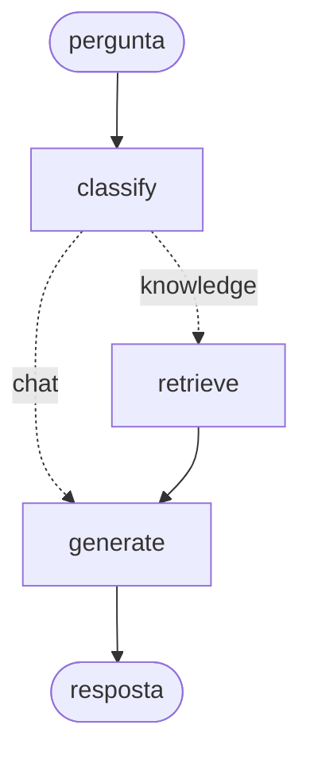

# Meridian AI Assistant

> Um assistente RAG sobre a documentação interna de uma empresa, a correr
> inteiramente na tua máquina.
> **Ollama + LangChain + LangGraph + Streamlit** · sem API keys · sem internet.

Projeto do Módulo 01 do AI Engineering Course. É a **v0.1** de um sistema que vai
crescer durante os dez módulos, até se tornar um sistema agêntico em produção.

> A **Meridian Digital** é uma empresa fictícia. Os dez documentos em `data/docs/`
> foram inventados para efeitos de formação. Nenhum dado é real.

---

## Índice

1. [O que isto faz](#1-o-que-isto-faz)
2. [Instalação](#2-instalação)
3. [Arquitetura](#3-arquitetura)
4. [Guia de leitura do código](#4-guia-de-leitura-do-código) ← **para dar a aula**
5. [Perguntas para demonstrar](#5-perguntas-para-demonstrar)
6. [Troubleshooting](#6-troubleshooting)
7. [O que este sistema ainda não faz](#7-o-que-este-sistema-ainda-não-faz)

---

## 1. O que isto faz

Fazes uma pergunta. O sistema:

1. **decide** se a pergunta precisa da documentação interna ou não;
2. se precisar, **procura** os pedaços mais relevantes por semelhança semântica;
3. **responde** com base neles, citando as fontes;
4. **lembra-se** do que foi dito antes, dentro da mesma conversa.

O "modo instrutor" da barra lateral mostra, a cada resposta, **que caminho o
sistema tomou**, **que pedaços recuperou** e **com que pontuação de semelhança**.
É o que transforma uma demonstração numa aula.

---

## 2. Instalação

### 2.1 Pré-requisitos

- Python 3.11+
- [Ollama](https://ollama.com/download)
- ~8 GB de disco livre, 16 GB de RAM recomendados

```bash
ollama pull llama3.1:8b        # ~4.9 GB · o modelo que gera as respostas
ollama pull nomic-embed-text   # ~274 MB · o modelo que gera os embeddings
```

Com **8 GB de RAM**, usa `ollama pull llama3.2:3b` e põe
`MERIDIAN_CHAT_MODEL=llama3.2:3b` no `.env`.

### 2.2 O projeto

**macOS / Linux**

```bash
python3 -m venv .venv && source .venv/bin/activate
pip install -r requirements.txt
```

**Windows (PowerShell)**

```powershell
python -m venv .venv; .venv\Scripts\Activate.ps1
pip install -r requirements.txt
```

### 2.3 Construir o índice e arrancar

```bash
python scripts/build_index.py     # uma vez, ~20 s
streamlit run app.py
```

Abre em `http://localhost:8501`.

> Também podes saltar o `build_index.py`: a própria aplicação oferece um botão
> para construir o índice na primeira utilização.

---

## 3. Arquitetura

```
                        Streamlit  (app.py)
                              |
                     LangGraph  (graph.py)
                              |
        ┌─────────────────────┼─────────────────────┐
        |                     |                     |
    classify              retrieve              generate
   decide a rota      procura no índice     escreve a resposta
        |                     |                     |
        |              knowledge.py            prompts.py
        |             InMemoryVectorStore
        |                     |
        └──────────► models.py  ◄─────────────────────┘
                  A FRONTEIRA DO PROVIDER
                              |
                     ChatOllama + OllamaEmbeddings
                              |
                        Ollama (local)
```

### O grafo



Três nós, uma aresta condicional, e um checkpointer que guarda o estado entre
turnos. Não é um `if/else` — é uma máquina de estados declarada, que o LangGraph
sabe desenhar, retomar e transmitir por nó.

### Ficheiros

| Ficheiro | Linhas | O que faz |
|---|---|---|
| `meridian/config.py` | ~80 | tudo o que muda entre máquinas |
| `meridian/models.py` | ~95 | **a fronteira do provider** — o único ficheiro que conhece o Ollama |
| `meridian/knowledge.py` | ~160 | documentos → pedaços → vetores → índice, e a pesquisa |
| `meridian/prompts.py` | ~90 | as três instruções: router, RAG, chat |
| `meridian/state.py` | ~45 | o `State` tipado do LangGraph |
| `meridian/graph.py` | ~230 | nós, arestas, routing e memória |
| `app.py` | ~230 | a interface |
| `scripts/build_index.py` | ~60 | a indexação, offline |
| `tests/test_graph.py` | ~150 | 11 testes que correm **sem** Ollama |

---

## 4. Guia de leitura do código

A ordem que funciona em sala, com o que dizer em cada paragem.

### Passo 1 · `models.py` — a fronteira do provider *(5 min)*

Começa aqui, mesmo antes de falar de RAG.

**O que mostrar:** que `get_chat_model()` devolve `BaseChatModel` e não
`ChatOllama`. O resto do projeto só pode contar com a interface comum.

**O que dizer:** *"Este é o único ficheiro que sabe que existe um Ollama. Para ir
para a AWS, mudam-se dois imports e duas linhas. É por isto que aprender local não
é conhecimento descartável."*

### Passo 2 · `knowledge.py` — a fase 1 do RAG *(15 min)*

**O que mostrar, por esta ordem:**

- `load_documents()` — o que é um `Document`: `page_content` + `metadata`.
  Insiste nos metadados: são o que permite citar a fonte e aplicar permissões.
- `split_documents()` — porque não enviamos o documento inteiro, e o que fazem
  o `chunk_size` e o `chunk_overlap`.
- `build_index()` — o passo caro: cada pedaço passa pelo modelo de embeddings.
- `search()` — **não há modelo de linguagem aqui.** É aritmética sobre vetores.

**Demonstração ao vivo:** corre `python scripts/build_index.py` e mostra a saída —
10 documentos, 31 pedaços, tamanho médio do pedaço, tempo. Depois muda o
`chunk_size` para 300 no `.env`, reconstrói, e mostra que passam a ser ~90 pedaços.
A conversa sobre chunking deixa de ser abstrata.

### Passo 3 · `state.py` — a primeira ideia do LangGraph *(5 min)*

**O que mostrar:** as cinco chaves do `AssistantState` e, sobretudo, o
`Annotated[list[AnyMessage], add_messages]`.

**O que dizer:** *"Um nó nunca devolve o estado inteiro. Devolve só as chaves que
mudou. E esta anotação — não código nosso — é o que faz o histórico crescer
sozinho."*

### Passo 4 · `graph.py` — o coração *(25 min)*

**`node_classify`** — o momento alto da aula. É o primeiro sítio onde o modelo
deixa de gerar texto e passa a **tomar uma decisão de controlo de fluxo**.
*"A diferença entre um workflow e um agente é apenas quantas destas decisões
entregas ao modelo."*
Mostra também o `try/except` com a heurística de recurso: *"o que fazes quando o
classificador falha?"*

**`node_retrieve`** — sem LLM. Só preenche o estado. Nós pequenos com uma
responsabilidade só são fáceis de testar e de substituir.

**`node_generate`** — duas coisas separadas: a montagem do prompt (que muda
conforme a rota) e a memória (`state["messages"][-N:]`).
*"O modelo não tem memória nenhuma. A conversa existe porque nós a reenviamos."*

**`route_question`** — uma função pura sobre o estado. Trivial de testar.

**`build_graph`** — declara nós, declara ligações, compila. O grafo é uma
**descrição** separada da execução — e é por isso que dá para o desenhar,
retomar a meio e transmitir por nó.

**`compile(checkpointer=...)`** — *"é isto, e não código nosso, que dá memória à
conversa. E é isto que tornará possível pausar para uma pessoa aprovar, quando
este sistema crescer."*

### Passo 5 · `app.py` — a interface *(10 min)*

**O que mostrar:**

- `@st.cache_resource` — o Streamlit re-executa o ficheiro todo a cada clique.
  Sem isto, o índice era lido do disco a cada tecla.
- `thread_id` na sessão — uma thread é uma conversa. Duas threads têm históricos
  independentes.
- `st.write_stream(stream_answer(...))` — o streaming não é um truque de
  interface: é literalmente assim que o modelo gera.
- `mostrar_meta()` — a rota tomada e os pedaços recuperados com as pontuações.

**O que dizer:** *"Este ficheiro não sabe o que é RAG, nem o que é Ollama. Sabe
desenhar uma conversa e chamar duas funções. A interface é a camada que mais
muda — e a que menos deve saber."*

### Passo 6 · `tests/test_graph.py` — o fecho *(5 min)*

```bash
pytest -q      # 11 passed
```

**O que dizer:** *"Onze testes, sem Ollama nenhum. A maior parte de um sistema de
IA é testável como código normal — só a chamada ao modelo é que não é. Isto é o
primeiro sinal de que isto é software e não um brinquedo."*

---

## 5. Perguntas para demonstrar

Estão todas nos botões da interface. Cada uma serve um propósito.

| Pergunta | O que demonstra |
|---|---|
| *Qual foi o CPA da campanha VG-Aquisicao-PT no Q3?* | RAG a funcionar: número exato, fonte citada |
| *Quem aprova um aumento de budget de 40 000 EUR?* | recuperação de uma tabela, não de prosa |
| *Quanto tempo demora o onboarding de um cliente?* | resposta que cruza duas secções do mesmo documento |
| *O que correu mal no incidente de tracking de setembro?* | resposta longa, com cronologia |
| **`Qual é o frequency cap para campanhas de iGaming?`** | ⭐ **os documentos contradizem-se** |
| **`Qual foi a receita da Meridian em 2019?`** | ⭐ **a resposta não existe** |

### As duas perguntas que valem a aula

**A contradição.** A política de compliance **v2** (setembro 2026) diz **3
impressões por semana**. O playbook de criativos **v1** (janeiro 2026) diz **5**.
Se `top_k` trouxer os dois pedaços, o modelo tem de assinalar a contradição e
dizer qual é mais recente — está instruído para isso no `RAG_SYSTEM`. Às vezes
consegue, às vezes escolhe um e ignora o outro.
*"É por isto que RAG não resolve alucinações. Muda o tipo de erro — e torna-o
auditável, que é o verdadeiro ganho."*

**O buraco.** A receita de 2019 não está em lado nenhum. O sistema deve responder
*"Não encontrei essa informação na documentação interna"*. Compara com o que
acontece se apagares essa instrução do `RAG_SYSTEM` — o modelo inventa um número.
*"A diferença entre um assistente utilizável e um perigoso são três linhas de
system prompt."*

### Para demonstrar a memória

```
1. Qual foi o CPA da campanha VG-Aquisicao-PT no Q3?
2. E qual era o target?
3. Quanto é que isso é em percentagem?
```

A pergunta 2 não menciona a campanha. Só funciona porque o histórico foi
reenviado. Carrega em **Nova conversa** e repete a pergunta 2 sozinha — deixa de
funcionar. É a demonstração mais barata e mais convincente de que o modelo não
tem memória nenhuma.

---

## 6. Troubleshooting

<details>
<summary><b>"Não consigo falar com o Ollama"</b></summary>

O servidor não está a correr.
- **macOS/Windows:** abre a aplicação Ollama.
- **Linux:** `ollama serve` num terminal à parte.

Confirma com `curl http://localhost:11434/api/tags`.
</details>

<details>
<summary><b>"Faltam modelos"</b></summary>

```bash
ollama pull llama3.1:8b
ollama pull nomic-embed-text
ollama list      # confirma os nomes exatos, com tag
```
</details>

<details>
<summary><b>As respostas ignoram os documentos</b></summary>

1. O índice foi construído? Barra lateral → deve dizer `Índice: store.json`.
2. Vê o "modo instrutor": a rota foi `knowledge` ou `chat`? Se foi `chat`, o
   classificador falhou — reformula a pergunta de forma mais concreta.
3. As pontuações de semelhança estão todas abaixo de ~0.4? Então o retriever não
   encontrou nada relevante e o problema é de indexação, não do modelo.
</details>

<details>
<summary><b>Mudei o chunk_size e nada mudou</b></summary>

O índice está em cache. **Reconstruir índice** na barra lateral, ou
`python scripts/build_index.py` no terminal.
</details>

<details>
<summary><b>Está muito lento</b></summary>

A primeira pergunta carrega o modelo para memória — as seguintes são muito mais
rápidas (`ollama ps` mostra o que está carregado). Se continuar lento, passa para
`llama3.2:3b` e baixa o `MERIDIAN_TOP_K` para 3.

Nota: cada pergunta faz **duas** chamadas ao modelo — uma para classificar, outra
para gerar. É o preço do routing, e é um bom tema de discussão.
</details>

<details>
<summary><b>O índice foi construído com um modelo de embeddings e mudei de modelo</b></summary>

Tens de reconstruir. Espaços vetoriais de modelos diferentes não são comparáveis.
O erro não rebenta — só devolve resultados maus. É um dos erros mais caros e mais
silenciosos em sistemas RAG.
</details>

---

## 7. O que este sistema ainda não faz

Não é uma lista de defeitos. É o programa dos próximos módulos.

| Limitação | Onde se resolve |
|---|---|
| Não consegue consultar APIs, bases de dados nem calcular de forma fiável | **tool calling** — M04 |
| A memória morre quando fechas o processo (`InMemorySaver`) | `SqliteSaver` / `PostgresSaver` — M05 |
| O índice é um ficheiro JSON em memória | pgvector / OpenSearch — M03 |
| Não há avaliação: a qualidade é julgada a olho | eval set + tracing — M07 |
| Não decide nada sozinho além da rota | agentes com LangGraph — M09 |
| Não escala, não tem autenticação, nem controlo de custo | FastAPI + Docker + AWS — M05/M06 |

### O caminho até um sistema agêntico

O que já cá está — **state**, **nós**, **aresta condicional**, **checkpointer** —
é exatamente a estrutura de um agente. Falta só uma coisa: dar ao modelo
**ferramentas** e deixá-lo escolher quando as usar.

```
hoje    classify → retrieve → generate          o modelo escolhe 1 caminho de 2
M04     + tools                                 o modelo escolhe que ferramenta usar
M09     + ciclos + validação + human-in-the-loop o modelo escolhe quantas vezes iterar
```

Um agente é um workflow em que mais arestas condicionais são escolhidas pelo
modelo. Nada mais misterioso do que isso.
